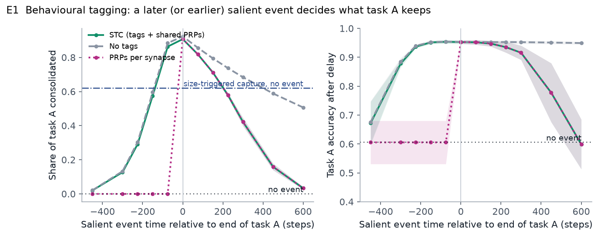
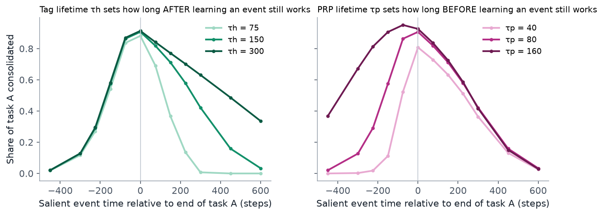
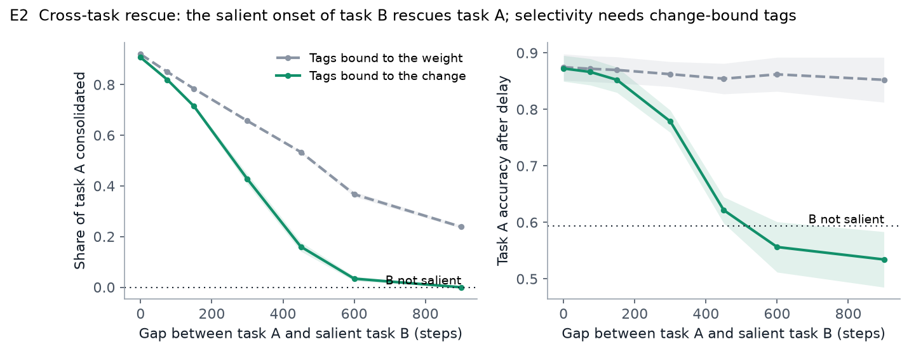
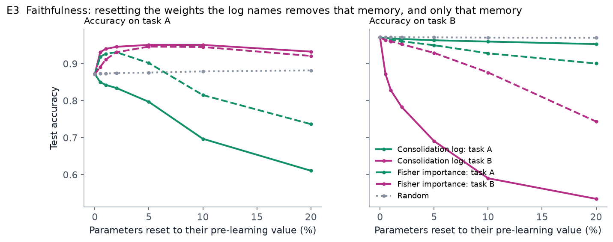
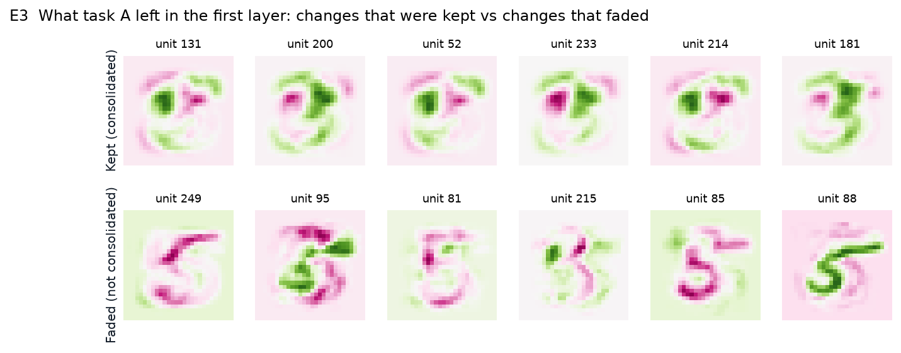
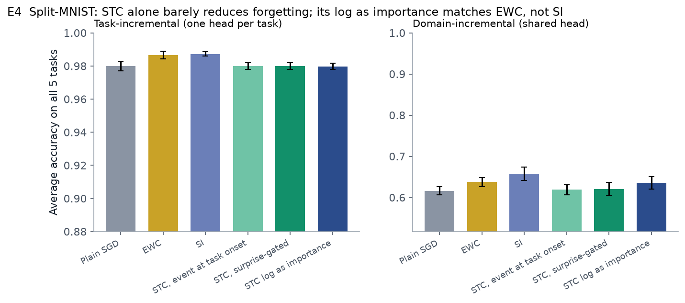

# RetroSTC-Net

Retroactive consolidation for neural networks, based on synaptic tagging and capture.

Can an event that happens *after* learning decide whether a network keeps what it learned?

According to the synaptic tagging and capture (STC) hypothesis (Frey & Morris, 1997), learning first causes a short-lived synaptic change (early-phase LTP) and leaves a temporary tag. The change becomes permanent (late-phase LTP) only if plasticity-related products (PRPs) arrive while the tag is still present, and these can be triggered by a separate salient event. Behaviourally, a novel experience shortly before or after weak learning makes the weak memory last (behavioural tagging; Moncada & Viola, 2007).

This project implements that mechanism in standard backprop-trained networks, tests whether the behavioural-tagging time window appears, and uses the network's own consolidation record as an explanation of what it remembers.



## Contribution

Related mechanisms exist: a decaying weight component with tag-and-capture against forgetting (Leimer, Herzog & Senn, 2019) and retroactive STC in spiking networks (Lehr, Luboeinski & Tetzlaff, 2022). New in this project:

- consolidation in a backprop-trained network that is decided retroactively, by a salience event occurring after learning
- a behavioural-tagging time-window test in network weights, including rescue of one task by another
- a consolidation log that explains what the network retained, validated with a faithfulness test

## Method

Each weight is split into a consolidated part `L` and a labile part `E`, with effective weight `w = L + E`. The optimiser updates `w` as usual; after each step:

| Biology | Network | Default |
|---|---|---|
| Early-phase LTP decays | `E ← E · exp(−1/τE)` | τE = 1000 steps |
| Synaptic tag | `h ← h · exp(−1/τh) + |Δw|` | τh = 150 steps |
| PRPs, shared per neuron | `p_unit ← p · exp(−1/τp) + α·s(t)` | τp = 80 steps |
| Capture | `c = clamp(κ · p_unit · [h > θ], 0, 1)`; `L += c·E`, `E −= c·E` | κ = 0.05 |
| Salient event | `s(t)`: a pulse, or a sudden jump in training loss | |

Labile change is tracked per learning episode, so every consolidated change can be traced to the task that produced it and the event that captured it. Implementation: [`stc/stc.py`](stc/stc.py); tests: [`tests/test_stc.py`](tests/test_stc.py).

## Results

Setup unless stated otherwise: MLP with two hidden layers of 256 units, SGD, two hard binary MNIST tasks (A: 3 vs 5, B: 4 vs 9), 5 seeds. Each run ends with 4000 steps without learning, so only consolidated memory remains. The main measure is the share of task A's learning that became permanent, since accuracy saturates quickly on these tasks. Full tables: [results/summary.md](results/summary.md).

### 1. Event timing determines what is kept

Brief training on task A, one salient pulse at a variable time (figure above).

| Event time relative to end of A | none | −300 | −150 | 0 | +150 | +300 | +600 |
|---|---|---|---|---|---|---|---|
| Share of A kept | 0.00 | 0.13 | 0.58 | 0.91 | 0.71 | 0.42 | 0.03 |

- Without an event nothing is kept; accuracy on A falls from 0.95 to 0.61 after the delay. Near the event it stays at about 0.95.
- Without tags the window stays open after learning: an event at +600 still keeps 51%.
- With PRPs made only at synapses tagged at event time, events before learning have no effect.
- Size-triggered capture (in the style of Li & van Rossum, 2020) keeps 62% without any event, but cannot be influenced by later events.



The two sides of the window have separate causes, as STC predicts. Tag lifetime τh shifts only the after-side (at +300: 0.01 / 0.42 / 0.63 for τh = 75 / 150 / 300). PRP lifetime τp shifts only the before-side (at −150: 0.11 / 0.58 / 0.91 for τp = 40 / 80 / 160).

### 2. Cross-task rescue

Task A, a gap, then task B, whose onset is salient.



| Gap between A and B | 0 | 150 | 300 | 600 | 900 | B not salient |
|---|---|---|---|---|---|---|
| Tags per weight | 0.92 | 0.78 | 0.66 | 0.37 | 0.24 | 0.00 |
| Tags per change | 0.91 | 0.71 | 0.43 | 0.03 | 0.00 | 0.00 |

- B's onset rescues A retroactively. Without salience neither task is kept (B: 0.52 instead of 0.97).
- With one tag per weight, B's own learning re-tags weights shared with A, so B's event also captures A's residual change long after A's tag has faded (24% at a 900-step gap). Binding each episode's change to its own tag restores a clean window.

### 3. Consolidation log as explanation

Log for one run:

> The "B onset" event consolidated 85% of task A (strongest hidden units 131, 52, 200, 214, 233) and 63% of task B (units 135, 132, 200, 211, 181).

Faithfulness is tested by deletion: parameters are ranked by the log's attribution to A or B, by Fisher importance for A or B, or at random, and the top-ranked parameters are reset to their pre-learning values.



| Reset 5% of parameters, ranked by | Accuracy A | Accuracy B |
|---|---|---|
| nothing reset | 0.872 | 0.971 |
| log, task A | 0.797 | 0.963 |
| log, task B | 0.951 | 0.691 |
| Fisher, task A | 0.902 | 0.950 |
| Fisher, task B | 0.946 | 0.929 |
| random | 0.876 | 0.971 |

- The log dissociates the two memories: removing A's attributed weights hurts A and spares B, and vice versa. Fisher importance does this far less clearly.
- Removing B's weights improves A (0.87 to 0.95), which shows B's interference with A.
- Evaluating only the consolidated weights at the end of task B gives higher accuracy on A (0.873) than the full weights (0.846): A is held in consolidated memory, and B's labile changes interfere with it.



First-layer features from task A that were consolidated, next to those that faded.

### 4. Forgetting on Split-MNIST

Five binary digit tasks in sequence, 500 steps each. Salient events come from a surprise detector that fires on sudden loss increases, so no task labels are used. Hyperparameters were tuned on a separate seed.



| Method | Task-incremental | Domain-incremental |
|---|---|---|
| Plain SGD | 0.980 | 0.616 |
| EWC | 0.987 | 0.637 |
| Synaptic Intelligence | 0.987 | 0.657 |
| STC, event at each task onset | 0.980 | 0.619 |
| STC, surprise-gated | 0.980 | 0.621 |
| STC log as importance, surprise-gated | 0.980 | 0.636 |

- STC alone barely reduces forgetting: it decides what becomes permanent, but consolidated weights are not protected from later learning.
- Using the consolidation log as importance in an EWC-style penalty reaches EWC level, with importance selected by surprising events after learning rather than fixed during it. It does not outperform Synaptic Intelligence.
- With one output head per task, all methods are near ceiling.

## Relevance

- In many applications importance becomes clear only later: fraud labels, clinical outcomes, user corrections. Retroactive consolidation fits that setting better than importance fixed at training time.
- For models that keep learning after deployment, the consolidation log records what was made permanent and what triggered it, and can be checked rather than assumed.

## Limitations

- Small MLPs on MNIST only; results demonstrate the mechanism, not performance at scale.
- Time is measured in training steps; time constants were set by hand.
- The deletion test resets weights to pre-learning values; other interventions may rank methods differently.
- The biological mapping is simplified: backprop is not a biological learning rule, PRPs are a single value per unit, and a hidden unit is not a neuron.

Next steps: a benchmark where importance is revealed only later (delayed rewards or labels), protection of consolidated weights, and extension to CNNs and LoRA fine-tuning of language models.

## Usage

```bash
python -m venv .venv
.venv/Scripts/python -m pip install -r requirements.txt   # macOS/Linux: .venv/bin/python
.venv/Scripts/python tests/test_stc.py
.venv/Scripts/python experiments/e1_window.py      # ~15 min on a laptop CPU
.venv/Scripts/python experiments/e2_cross.py       # ~6 min
.venv/Scripts/python experiments/e3_explain.py     # ~1 min
.venv/Scripts/python experiments/e4_splitmnist.py  # ~16 min
.venv/Scripts/python make_figures.py               # figures, results/summary.md, demo/index.html
```

MNIST is downloaded to `data/` on first run. `demo/index.html` contains an interactive version of the results.

## References

- Frey, U. & Morris, R. G. M. (1997). Synaptic tagging and long-term potentiation. *Nature* 385:533–536.
- Redondo, R. L. & Morris, R. G. M. (2011). Making memories last: the synaptic tagging and capture hypothesis. *Nat. Rev. Neurosci.* 12:17–30.
- Moncada, D. & Viola, H. (2007). Induction of long-term memory by exposure to novelty requires protein synthesis: evidence for a behavioral tagging. *J. Neurosci.* 27:7476–7481.
- Leimer, P., Herzog, M. & Senn, W. (2019). Synaptic weight decay with selective consolidation enables fast learning without catastrophic forgetting. *bioRxiv* 613265.
- Li, H. L. & van Rossum, M. C. W. (2020). Energy efficient synaptic plasticity. *eLife* 9:e50804.
- Lehr, A. B., Luboeinski, J. & Tetzlaff, C. (2022). Neuromodulator-dependent synaptic tagging and capture retroactively controls neural coding in spiking neural networks. *Sci. Rep.* 12.
- Kirkpatrick, J. et al. (2017). Overcoming catastrophic forgetting in neural networks. *PNAS* 114:3521–3526.
- Zenke, F., Poole, B. & Ganguli, S. (2017). Continual learning through synaptic intelligence. *ICML.*
- van de Ven, G. M., Tuytelaars, T. & Tolias, A. S. (2022). Three types of incremental learning. *Nat. Mach. Intell.* 4:1185–1197.
- Hooker, S. et al. (2019). A benchmark for interpretability methods in deep neural networks. *NeurIPS.*

## Licence

MIT, see [LICENSE](LICENSE).
